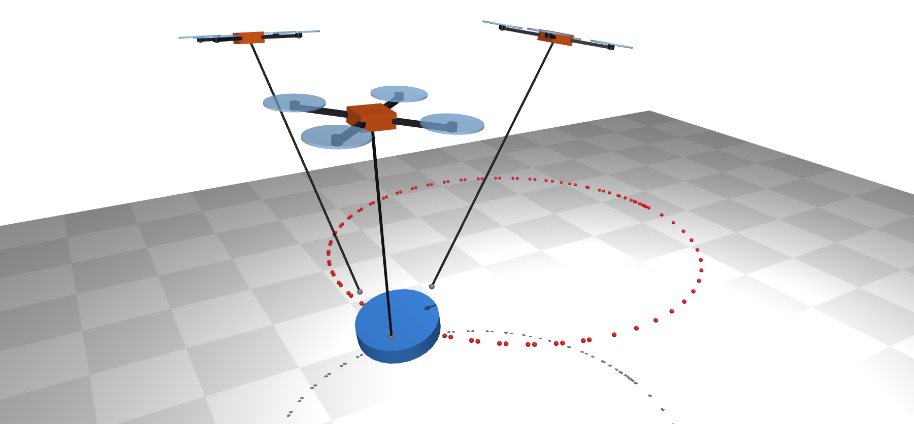
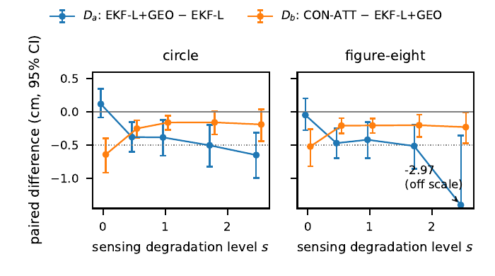
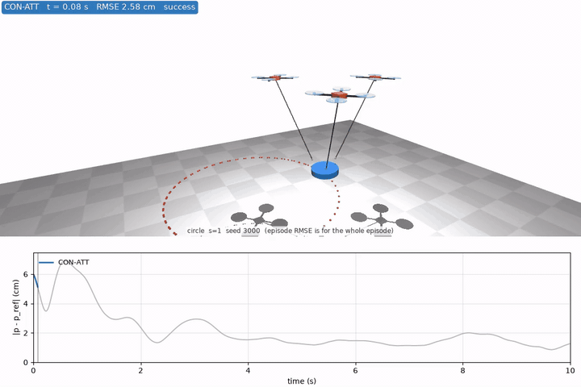
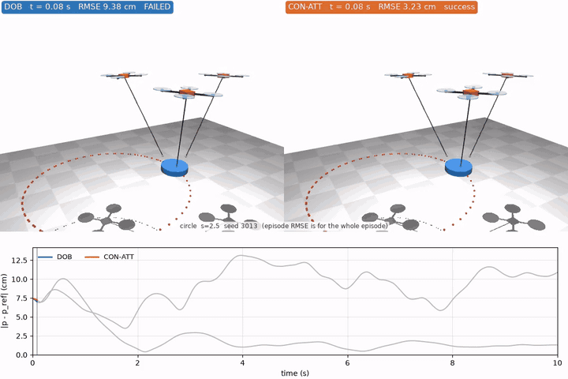
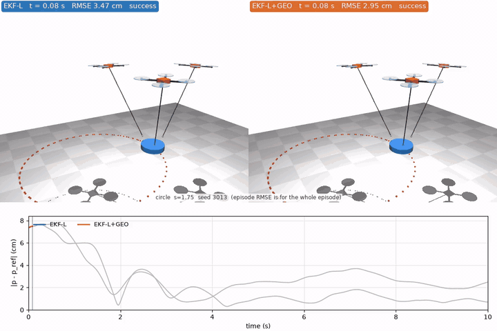
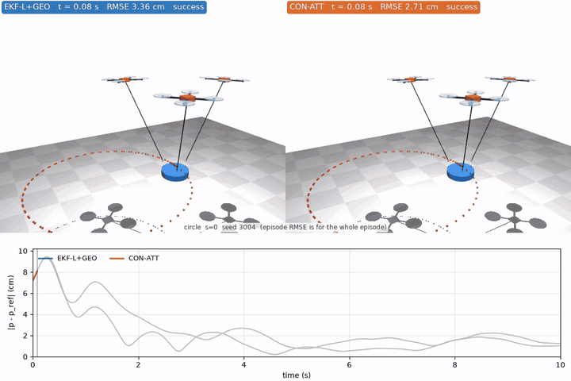

# What to Share in Cooperative Cable-Suspended Transport

[中文版](README.zh-TW.md) | [Paper (PDF)](paper/workshop/main.pdf)

Three quadrotors carry one payload on ropes. The payload's mass and center-of-mass offset are unknown, and each quadrotor runs its own MPPI controller and estimator. Teammates can share **geometry** (their positions and rope directions) or run a **consensus estimator** that exchanges measurements and filter information to estimate the shared payload parameters jointly. Which is worth sharing as onboard sensing degrades? We study this in MuJoCo with a single sensing degradation level $s$ (0 = clean, 1 = moderate, 2.5 = the worst level tested), adding each kind of sharing in turn to a tuned local EKF. Hypotheses, tests and decision rules were pre-registered (`docs/PREREG.md`) and frozen before the formal run of 3240 episodes on fresh seeds.



## Main results

- Both gains are small: a few millimetres, against the consensus estimator's tracking error of 2.3–3.7 cm.
- Teammate geometry gives a detectable gain at all four degraded levels ($s \ge 0.5$): −0.38 to −0.65 cm in paired payload-position RMSE (excluding the figure-eight at $s=2.5$, where one failed EKF-L episode inflates the formal value to −2.97 cm), about 11–14% of the local EKF's error. With clean sensing ($s=0$) the evidence is insufficient.
- Replacing the geometry-augmented EKF by the consensus estimator gives a further gain that is detectable from clean to moderately degraded sensing ($s \le 1$; −0.16 to −0.64 cm). For $s \ge 1.75$ the evidence is insufficient, which is not the same as showing there is no effect.
- That further gain bundles three changes that were not separated (exchange of measurements and estimates, estimation of the center-of-mass offset, and a different filter form), so it is not the value of exchanging estimates alone.
- Under ideal links and with three quadrotors, a consensus estimator truncated to 2 iterations stays within the pre-registered ±0.25 cm band of its centralized counterpart at every $s$ (largest difference 0.05 cm). The band is of the same order as the gains, so the test alone says little, and the result does not show that going distributed costs nothing.
- We claim no trend in these two gains across sensing levels. The pre-registered tests are one-sided; with two-sided tests (post hoc) neither gain would count as supported at $s=1$.
- Everything comes from one simulator, one team size ($N=3$) and one payload geometry.

The full method, the statistics (paired sign-flip tests, Holm correction, TOST), the limitations and the post hoc analyses are in the paper (4 pages of main text plus references and appendices).



*$D_a$ = EKF-L+GEO − EKF-L (the geometry gain) and $D_b$ = CON-ATT − EKF-L+GEO (the further gain of the consensus estimator), mean with 95% bootstrap CI over 40 seeds; negative is better; dotted line is the pre-registered practical threshold −0.5 cm. The figure-eight $s=2.5$ point is dominated by one failed EKF-L episode (see the paper).*

## Videos

All clips are renders from the formal simulator, with a payload position-error plot underneath. For the comparison clips, the sensing level was picked after the results were known: $s=1.75$ for geometry (its mean effect reaches the pre-registered −0.5 cm there and also at $s=2.5$; no reason for choosing 1.75 was recorded), $s=0$ for the consensus estimator (the only level where its mean effect reaches −0.5 cm), and the worst level for DOB. Within a level, the shown episode is chosen by a fixed rule (not by how it looks), and its RMSE is checked against the formal results before rendering. Details: [results/media/README.md](results/media/README.md). The animations play inline; click one for the full-resolution MP4.

**Overview: the consensus estimator (CON-ATT) at moderate sensing, s = 1.**

[](results/media/hero_con_s1.mp4)

**Worst sensing level, s = 2.5: a simple residual-filter baseline (DOB) stays mostly 6–13 cm off the reference and misses the success criterion; CON-ATT tracks.** DOB misses the criterion in 22 of 80 episodes at s = 2.5, CON-ATT in none; none of these episodes diverges. The shown episode is the median DOB failure on the circle.

[](results/media/dob_failure_s25.mp4)

**What teammate geometry adds, s = 1.75: local EKF vs EKF + geometry.** The episode closest to the mean gap (5 mm). The two scenes look almost the same; the effect is millimetre-scale and shows up only in the error plot.

[](results/media/geo_vs_local_s175.mp4)

**What the consensus estimator adds on top, s = 0: EKF + geometry vs CON-ATT.** The episode closest to the mean gap (6 mm); again visible only in the error plot.

[](results/media/con_vs_geo_s0.mp4)

## Quick start

Python 3.12, CPU only.

```bash
python3 -m venv .venv
.venv/bin/pip install -r requirements.lock --extra-index-url https://download.pytorch.org/whl/cpu
.venv/bin/pip install -e .
.venv/bin/pytest -q                  # unit tests
bash scripts/reproduce.sh            # fast: recompute every test, table and figure from the saved episodes
bash scripts/reproduce.sh --full     # rerun all 3240 formal episodes first (hours on a desktop CPU)
```

`requirements.lock` pins the environment the results were produced with (MuJoCo 3.17.0, NumPy 2.5.4, CPU PyTorch 2.14.1); install from it rather than from `pyproject.toml`, which does not list PyTorch. `--full` renames the published `episodes.jsonl` to `episodes.published.jsonl` before rerunning; if a full run is interrupted, restore that file before running the fast path. `experiments/prereg_power.py` reads the pilot sweep in `results/p2d/`, which is included; pilot data are not evidence. `experiments/p2d_run.py` is the pilot tuning script and is kept for reference.

## Repository layout

| Path | Contents |
|---|---|
| `src/smpc/envs/` | MuJoCo quadrotor and multi-quadrotor rope-payload environments |
| `src/smpc/control/` | Geometric PD, batched MPPI, reference trajectories |
| `src/smpc/adapt/` | Estimators: DOB, local EKF, EKF with teammate geometry, consensus (HCMCI), centralized |
| `src/smpc/eval/` | Episode runners and the sensing model |
| `experiments/` | Formal run (`prereg_run.py`), analysis (`prereg_analyze.py`), power analysis, pilot tuning (`p2d_run.py`), video rendering |
| `configs/mppi_frozen.json` | MPPI hyper-parameters, frozen before the study |
| `docs/PREREG.md` | The frozen pre-registration (in Chinese), with the method specs it builds on in `docs/notes/` |
| `results/prereg/` | All 3240 formal episodes (`episodes.jsonl`), test tables and a summary (`PREREG_results.md`) |
| `results/p2d/`, `results/p2c/` | Pilot data and reports that the pre-registration cites (not evidence) |
| `results/media/` | Videos and how they were selected |
| `paper/workshop/` | LaTeX source, figures, compiled `main.pdf`, `NUMBERS.md` (where every number in the paper comes from) and `scripts/` (figures and the post hoc recomputations) |
| `scripts/reproduce.sh` | One command from saved episodes to tables and figures |

## About the pre-registration

The freeze is commit `5dd3cf7` in the author's private development repository. This public repository is a clean snapshot, and `docs/PREREG.md` here is byte-identical to the frozen file (SHA-256 `e4997aa940f67d45ee91a318326d022e56c005e560a43df04ce24612ba92ee2a`). There is no third-party timestamp. Pilot data (seeds 2020–2029, 2100–2119, 2200–2219) were used for tuning and planning and are not counted as evidence; the formal run used seeds 3000–3039 with no deviation from the frozen protocol. The pre-registration cites `docs/PROGRESS.md`, an unpublished development log, and `results/p2c_ident/`, which is not included; the other pilot files it cites are in `results/p2d/` and `results/p2c/`. The two-sided p-values that it promised to list are in Appendix B of the paper.

## Citation

```bibtex
@misc{ho2026whattoshare,
  title  = {What to Share in Cooperative Cable-Suspended Transport: A Preregistered
            Simulation Study Across Sensing Quality},
  author = {Ho, Hao-Ting},
  year   = {2026},
  note   = {Workshop paper draft},
  url    = {https://github.com/Jadiouo/what-to-share-cable-transport}
}
```

## License

MIT, see [`LICENSE`](LICENSE).
