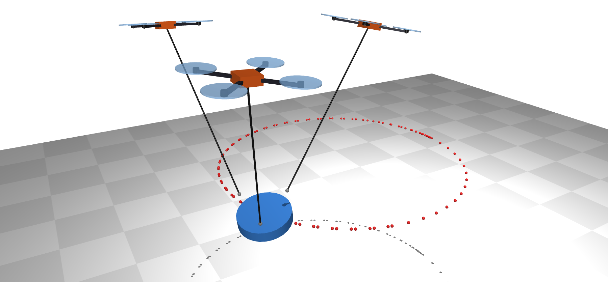
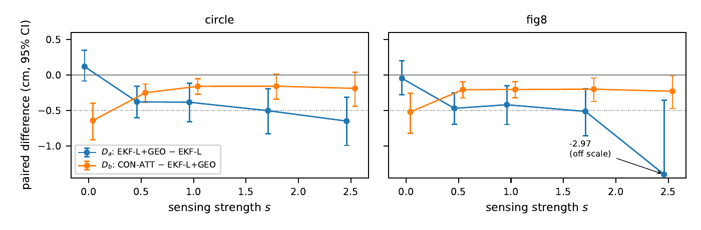
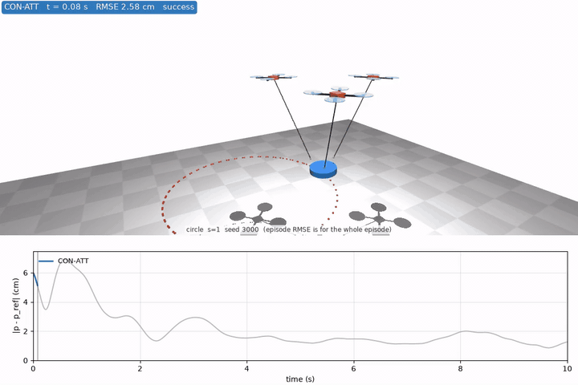
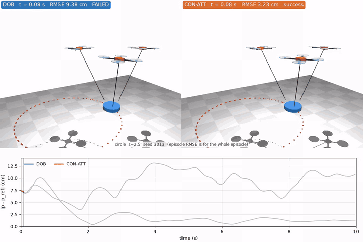
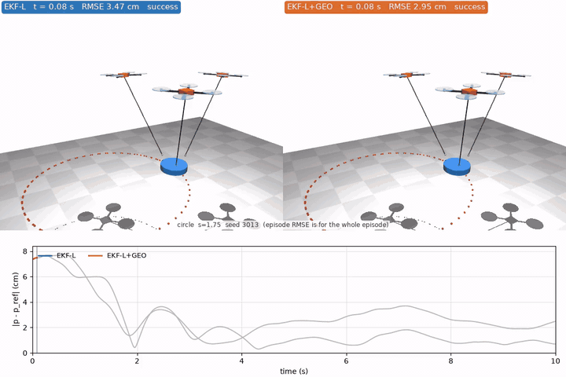
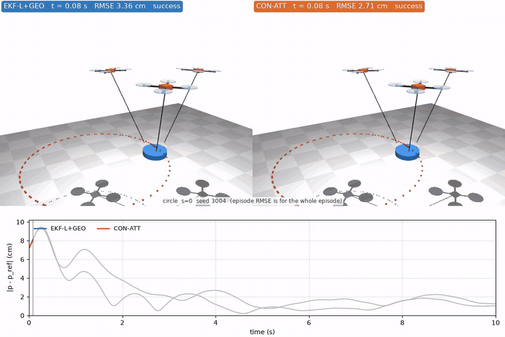

# What to Share Depends on Sensing Quality

[中文版](README.zh-TW.md) | [Paper (PDF)](paper/workshop/main.pdf)

Three quadrotors carry one payload on ropes. The payload's mass and center-of-mass offset are unknown, and each quadrotor runs its own MPPI controller and estimator. Teammates can share **geometry** (their positions and rope directions) or **estimates** (a consensus estimator over the shared payload parameters). Which one is worth sharing as onboard sensing degrades? We study this in MuJoCo with a single sensing-strength knob $s$ (0 = clean, 1 = moderate, 2.5 = the strongest level tested). Hypotheses, tests and decision rules were pre-registered (`docs/PREREG.md`) and frozen before the formal run of 3240 episodes on fresh seeds.



## Main results

- The answer depends on sensing quality, but it does not change smoothly with $s$.
- With clean sensing ($s=0$), only the consensus estimator's gain over the geometry-augmented EKF is detectable.
- For $s \ge 0.5$, adding teammate geometry to a strong local EKF gives a small, detectable gain: −0.38 to −0.65 cm in paired payload-position RMSE (excluding fig8 at $s=2.5$, where one failed EKF-L episode inflates the formal value to −2.97 cm), about 12–14% of the EKF's RMSE, with the same sign at every $s$ and no trend claimed.
- The consensus estimator's further gain over geometry is detectable for $s \le 1$ (−0.16 to −0.64 cm). For $s \ge 1.75$ the evidence is insufficient, which is not the same as showing there is no effect.
- A consensus estimator truncated to 2 iterations stays within the pre-registered ±0.25 cm band of its centralized counterpart at every $s$ (largest difference 0.05 cm), for $N=3$ with ideal links. The band is of the same order as the other effects, so this is weak evidence and does not show that going distributed costs nothing.
- All effects are millimetre-scale (CON-ATT's RMSEs are 2.4–3.7 cm), from one simulator, one team size ($N=3$) and one payload geometry.

The full method, the statistics (paired sign-flip tests, Holm correction, TOST) and the limitations are in the paper.



*$D_a$ = EKF-L+GEO − EKF-L (what geometry adds) and $D_b$ = CON-ATT − EKF-L+GEO (what the consensus estimator adds on top), mean with 95% bootstrap CI over 40 seeds; negative is better; dotted line is the pre-registered meaningful effect −0.5 cm. The fig8 $s=2.5$ point is dominated by one failed EKF-L episode (see the paper).*

## Videos

All clips are renders from the formal simulator, with a payload position-error plot underneath. For the comparison clips, the sensing level is the cell where the effect reaches the pre-registered −0.5 cm (or, for DOB, the harshest level); within it, the shown episode is chosen by a fixed rule (not by how it looks), and its RMSE is checked against the formal results before rendering. Details: [results/media/README.md](results/media/README.md). The animations play inline; click one for the full-resolution MP4.

**Overview: the consensus estimator (CON-ATT) at moderate sensing, s = 1.**

[](results/media/hero_con_s1.mp4)

**Harsh sensing, s = 2.5: a simple disturbance observer (DOB) stays mostly 6–13 cm off the reference and fails the success criterion; CON-ATT tracks.** DOB fails in 22 of 80 episodes at s = 2.5, CON-ATT in none. The shown episode is the median DOB failure on the circle.

[](results/media/dob_failure_s25.mp4)

**What teammate geometry adds, s = 1.75: local EKF vs EKF + geometry.** The episode closest to the mean gap (5 mm). The two scenes look almost the same; the effect is millimetre-scale and shows up only in the error plot.

[](results/media/geo_vs_local_s175.mp4)

**What the consensus estimator adds on top, s = 0: EKF + geometry vs CON-ATT.** The episode closest to the mean gap (6 mm); again visible only in the error plot.

[](results/media/con_vs_geo_s0.mp4)

## Quick start

Python 3.12, CPU only.

```bash
python3 -m venv .venv
.venv/bin/pip install -r requirements.lock --extra-index-url https://download.pytorch.org/whl/cpu
.venv/bin/pip install -e .
.venv/bin/pytest -q                  # unit tests
bash scripts/reproduce.sh            # fast: recompute every test, table and figure from the saved episodes
bash scripts/reproduce.sh --full     # rerun all 3240 formal episodes first (hours on a desktop CPU)
```

`requirements.lock` pins the environment the results were produced with (MuJoCo 3.17.0, NumPy 2.5.4, CPU PyTorch 2.14.1); install from it rather than from `pyproject.toml`, which does not list PyTorch. `--full` renames the published `episodes.jsonl` to `episodes.published.jsonl` before rerunning; if a full run is interrupted, restore that file before running the fast path. `experiments/p2d_run.py` and `prereg_power.py` read pilot data that is not included; they are kept for reference.

## Repository layout

| Path | Contents |
|---|---|
| `src/smpc/envs/` | MuJoCo quadrotor and multi-quadrotor rope-payload environments |
| `src/smpc/control/` | Geometric PD, batched MPPI, reference trajectories |
| `src/smpc/adapt/` | Estimators: DOB, local EKF, EKF with teammate geometry, consensus (HCMCI), centralized |
| `src/smpc/eval/` | Episode runners and the sensing model |
| `experiments/` | Formal run (`prereg_run.py`), analysis (`prereg_analyze.py`), power analysis, pilot tuning (`p2d_run.py`), video rendering |
| `configs/mppi_frozen.json` | MPPI hyper-parameters, frozen before the study |
| `docs/PREREG.md` | The frozen pre-registration (in Chinese), with the method specs it builds on in `docs/notes/` |
| `results/prereg/` | All 3240 formal episodes (`episodes.jsonl`), test tables and a summary (`PREREG_results.md`) |
| `results/media/` | Videos and how they were selected |
| `paper/workshop/` | LaTeX source, figures, compiled `main.pdf`, and `NUMBERS.md` (where every number in the paper comes from) |
| `scripts/reproduce.sh` | One command from saved episodes to tables and figures |

## About the pre-registration

The freeze is commit `5dd3cf7` in the author's private development repository. This public repository is a clean snapshot, and `docs/PREREG.md` here is byte-identical to the frozen file (SHA-256 `e4997aa940f67d45ee91a318326d022e56c005e560a43df04ce24612ba92ee2a`). There is no third-party timestamp. Pilot data (seeds 2020–2029, 2100–2119, 2200–2219) were used for tuning and planning and are not counted as evidence; the formal run used seeds 3000–3039 with no deviation from the frozen protocol.

## Citation

```bibtex
@misc{ho2026whattoshare,
  title  = {What to Share Depends on Sensing Quality: A Preregistered Simulation
            Study of Cooperative Cable-Suspended Transport},
  author = {Ho, Hao-Ting},
  year   = {2026},
  note   = {Workshop paper draft},
  url    = {https://github.com/Jadiouo/what-to-share-cable-transport}
}
```

## License

MIT, see [`LICENSE`](LICENSE).
