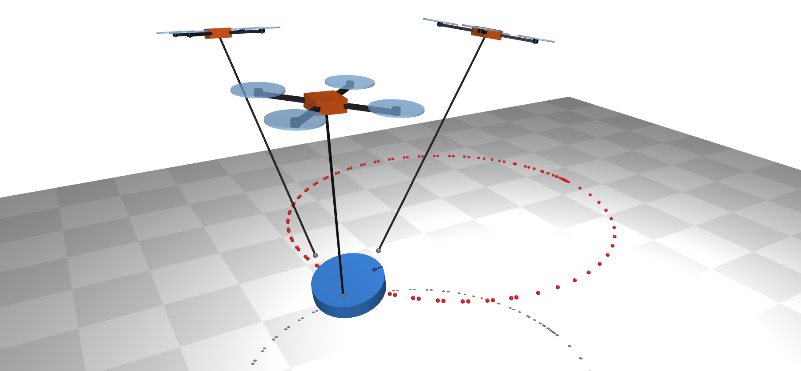
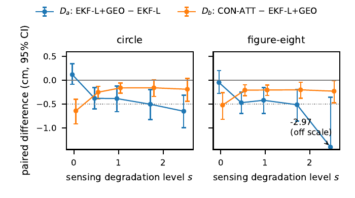
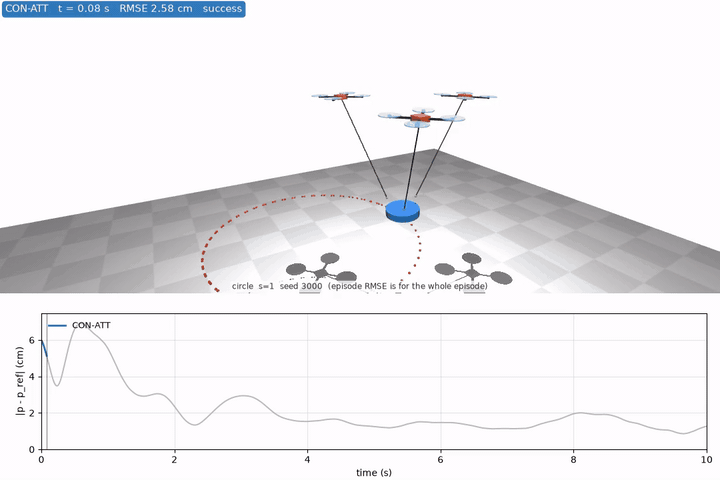
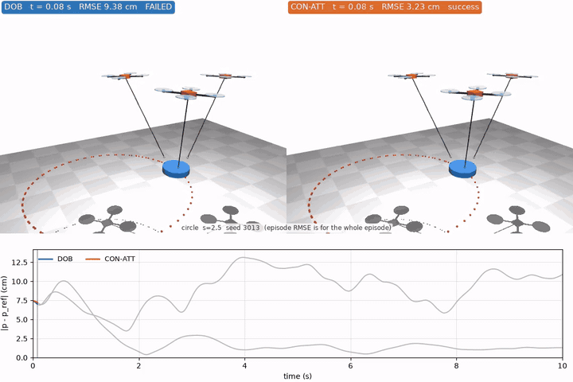
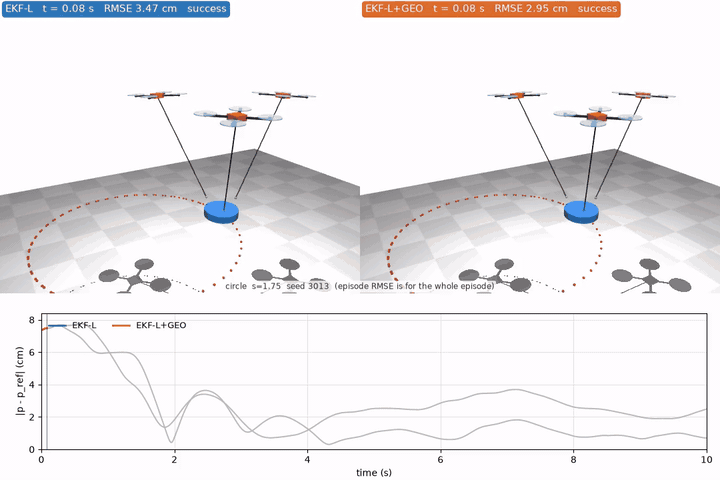
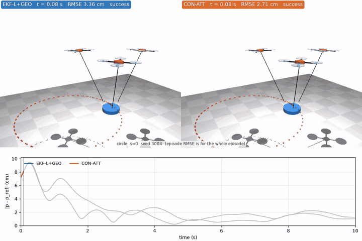

# 協作吊掛搬運該分享什麼

[English](README.md) | [論文（PDF）](paper/workshop/main.pdf)

三台四旋翼用繩子一起吊一個 payload。payload 的質量和重心偏移都是未知的，每台四旋翼各自跑自己的 MPPI 控制器和估計器。隊友之間可以分享**幾何資訊**（自己的位置和繩子方向），或改跑一個 **consensus 估計器**，互相交換量測和濾波器資訊，一起估 payload 的共同參數。當機上感測變差時，哪一種值得分享？我們在 MuJoCo 裡用一個感測劣化等級 $s$ 來研究這件事（0 = 乾淨，1 = 中等，2.5 = 測試過最差的等級），把兩種分享依序加到調過的本地 EKF 上。假說、檢定方法和判定規則都事先預註冊（`docs/PREREG.md`），在正式實驗之前就凍結。正式實驗用沒看過的新 seeds 跑了 3240 集。



## 主要結果

- 兩種增益都很小：只有幾毫米，而 consensus 估計器本身的追蹤誤差是 2.3–3.7 cm。
- 隊友幾何資訊在四個劣化等級（$s \ge 0.5$）都有偵測得到的增益：payload 位置 RMSE 的配對差是 −0.38 到 −0.65 cm（不含 figure-eight 在 $s=2.5$ 的那一格，那裡有一集 EKF-L 失敗，把正式值拉到 −2.97 cm），約為本地 EKF 誤差的 11–14%。感測乾淨時（$s=0$）證據不足。
- 把「EKF 加幾何」換成 consensus 估計器，還有進一步的增益，在乾淨到中等劣化（$s \le 1$）偵測得到（−0.16 到 −0.64 cm）。$s \ge 1.75$ 時證據不足，這不等於證明沒有效果。
- 這個進一步的增益綑了三個沒有分開的改動（交換量測與估計、估計重心偏移、不同的濾波器形式），所以它不是「交換估計」單獨的價值。
- 理想通訊、三台機的條件下，只迭代 2 次的 consensus 估計器在每個 $s$ 都落在和集中式版本相差 ±0.25 cm 的預註冊區間內（最大差 0.05 cm）。這個區間和增益是同一個量級，所以光是通過檢定說明不了多少，也不代表改成分散式就沒有損失。
- 我們不主張這兩個增益隨感測等級有趨勢。預註冊的檢定是單尾的；改用雙尾（事後分析）的話，兩個增益在 $s=1$ 都不算成立。
- 所有結果只來自一個模擬器、一種隊伍大小（$N=3$）和一種 payload 幾何。

完整方法、統計（配對 sign-flip 檢定、Holm 校正、TOST）、限制和事後分析都寫在論文裡（正文 4 頁，另有參考文獻與附錄）。



*$D_a$ = EKF-L+GEO − EKF-L（幾何增益），$D_b$ = CON-ATT − EKF-L+GEO（consensus 估計器的進一步增益）。圖上是 40 個 seed 的平均和 95% bootstrap 信賴區間，負值代表比較好。虛線是預註冊的實質門檻 −0.5 cm。figure-eight 在 $s=2.5$ 的那個點主要是被一集 EKF-L 失敗拉動的（見論文）。*

## 影片

所有影片都是用正式實驗的模擬器渲染的，下方附 payload 位置誤差圖。對照影片用哪個感測等級，是看過結果之後才選的：幾何那部用 $s=1.75$（平均效果在這裡和 $s=2.5$ 都達到預註冊的 −0.5 cm；當時沒有留下選 1.75 的理由），consensus 估計器那部用 $s=0$（它的平均效果只有在這一格達到 −0.5 cm），DOB 那部用最差的等級。在選定的等級裡挑哪一集，由固定規則決定，不看畫面好不好看。出片前，那一集重跑的 RMSE 都會和正式結果核對。細節見 [results/media/README.md](results/media/README.md)。動畫會直接在頁面上播放，點一下可以看高解析度的 MP4。

**總覽：中等感測（s = 1）下的 consensus 估計器（CON-ATT）。**

[](results/media/hero_con_s1.mp4)

**最差的感測等級（s = 2.5）：簡單的殘差濾波基線（DOB）大部分時間偏離 6–13 cm，沒有達到成功標準；CON-ATT 則跟得上。** s = 2.5 時，DOB 在 80 集裡有 22 集沒達標，CON-ATT 一集都沒有；這些集沒有任何一集發散。影片裡這一集，是 circle 軌跡上 DOB 未達標集的中位數。

[](results/media/dob_failure_s25.mp4)

**隊友幾何資訊帶來什麼（s = 1.75）：本地 EKF 對 EKF 加幾何。** 影片是差距最接近平均值（5 mm）的那一集。兩邊畫面看起來幾乎一樣，因為效果是毫米級，只有誤差圖看得出差別。

[](results/media/geo_vs_local_s175.mp4)

**consensus 估計器在幾何之上再帶來什麼（s = 0）：EKF 加幾何對 CON-ATT。** 影片是差距最接近平均值（6 mm）的那一集，一樣只有誤差圖看得出差別。

[](results/media/con_vs_geo_s0.mp4)

## 快速開始

需要 Python 3.12，只用 CPU。

```bash
python3 -m venv .venv
.venv/bin/pip install -r requirements.lock --extra-index-url https://download.pytorch.org/whl/cpu
.venv/bin/pip install -e .
.venv/bin/pytest -q                  # 單元測試
bash scripts/reproduce.sh            # 快速：從存好的 episodes 重算所有檢定、表格和圖
bash scripts/reproduce.sh --full     # 先重跑全部 3240 集正式實驗（桌機 CPU 要好幾個小時）
```

`requirements.lock` 鎖定了產生結果時的環境（MuJoCo 3.17.0、NumPy 2.5.4、CPU 版 PyTorch 2.14.1）。請用它安裝，不要只用 `pyproject.toml`，因為後者沒有列 PyTorch。`--full` 重跑前，會先把公開的 `episodes.jsonl` 改名成 `episodes.published.jsonl`；全量重跑中途中斷的話，請先把這個檔案改回原名，再跑快速版。`experiments/prereg_power.py` 要讀的 pilot 掃描資料在 `results/p2d/`，已包含在 repo 裡；pilot 資料不算證據。`experiments/p2d_run.py` 是 pilot 調參腳本，留著供參考。

## 資料夾結構

| 路徑 | 內容 |
|---|---|
| `src/smpc/envs/` | MuJoCo 四旋翼，以及多機繩吊 payload 環境 |
| `src/smpc/control/` | 幾何 PD、批次 MPPI、參考軌跡 |
| `src/smpc/adapt/` | 估計器：DOB、本地 EKF、EKF 加隊友幾何、consensus（HCMCI）、集中式 |
| `src/smpc/eval/` | 單集執行器和感測模型 |
| `experiments/` | 正式實驗（`prereg_run.py`）、分析（`prereg_analyze.py`）、檢定力分析、pilot 調參（`p2d_run.py`）、影片渲染 |
| `configs/mppi_frozen.json` | 研究開始前就凍結的 MPPI 超參數 |
| `docs/PREREG.md` | 凍結的預註冊文件（中文），它所依據的方法規格在 `docs/notes/` |
| `results/prereg/` | 全部 3240 集正式結果（`episodes.jsonl`）、檢定表和摘要（`PREREG_results.md`） |
| `results/p2d/`、`results/p2c/` | 預註冊引用的 pilot 資料與報告（不算證據） |
| `results/media/` | 影片，以及每部影片怎麼挑的 |
| `paper/workshop/` | LaTeX 原始檔、圖、編譯好的 `main.pdf`、`NUMBERS.md`（論文裡每個數字的出處），以及 `scripts/`（作圖與事後分析的重算腳本） |
| `scripts/reproduce.sh` | 一行指令，從存好的 episodes 重算出表和圖 |

## 關於預註冊

凍結點是作者私人開發 repo 裡的 commit `5dd3cf7`。這個公開 repo 是整理過的乾淨版本，裡面的 `docs/PREREG.md` 和凍結的檔案逐位元相同（SHA-256 `e4997aa940f67d45ee91a318326d022e56c005e560a43df04ce24612ba92ee2a`）。凍結沒有第三方時間戳。pilot 資料（seeds 2020–2029、2100–2119、2200–2219）只用來調參和規劃，不算進證據。正式實驗用 seeds 3000–3039，沒有偏離凍結的協定。預註冊文件引用的 `docs/PROGRESS.md` 是未公開的開發紀錄，`results/p2c_ident/` 沒有包含在 repo 裡；它引用的其他 pilot 檔案在 `results/p2d/` 和 `results/p2c/`。預註冊說要另列的雙尾 p 值，寫在論文的附錄 B。

## 引用

```bibtex
@misc{ho2026whattoshare,
  title  = {What to Share in Cooperative Cable-Suspended Transport: A Preregistered
            Simulation Study Across Sensing Quality},
  author = {Ho, Hao-Ting},
  year   = {2026},
  note   = {Workshop paper draft},
  url    = {https://github.com/Jadiouo/what-to-share-cable-transport}
}
```

## 授權

MIT，見 [`LICENSE`](LICENSE)。
