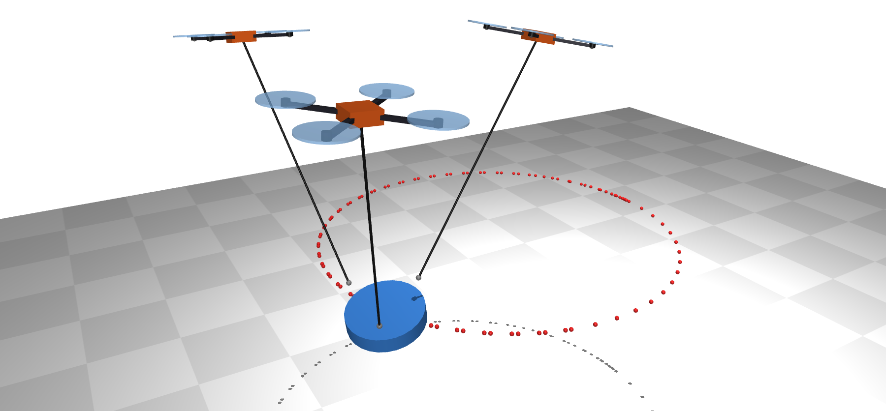
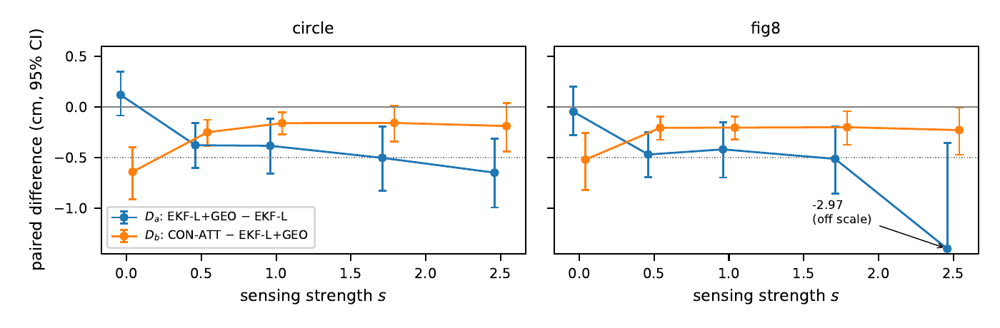
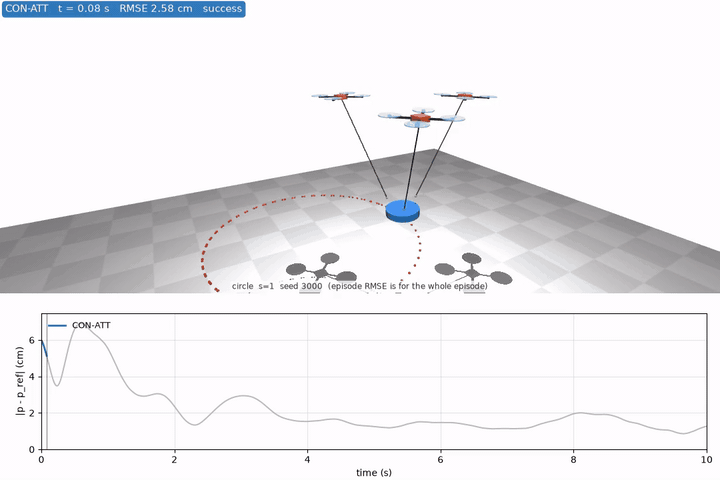
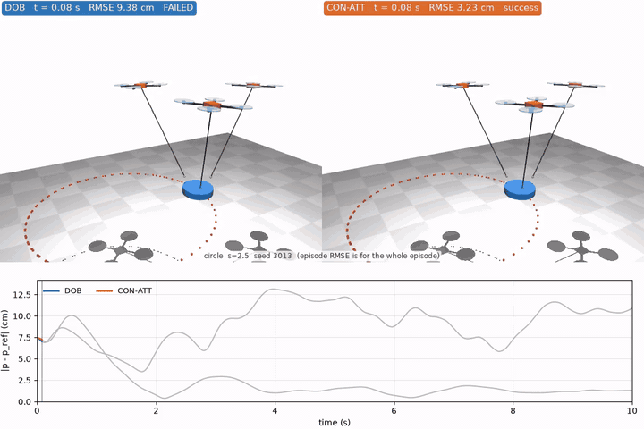
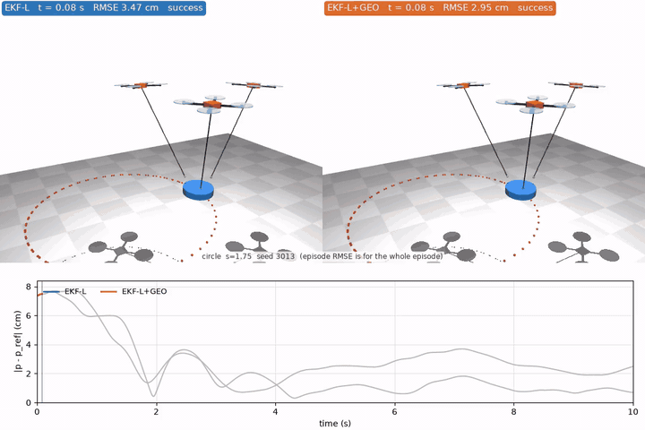
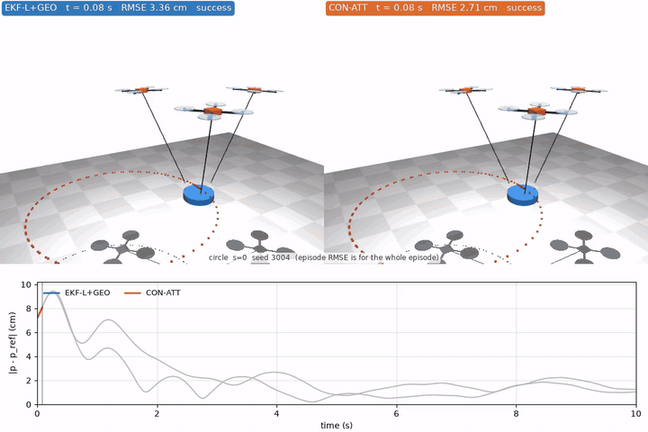

# 該分享什麼，取決於感測品質

[English](README.md) | [論文（PDF）](paper/workshop/main.pdf)

三台四旋翼用繩子一起吊一個 payload。payload 的質量和重心偏移都是未知的，每台四旋翼各自跑自己的 MPPI 控制器和估計器。隊友之間可以分享兩種東西：**幾何資訊**（自己的位置和繩子方向），或**估計值**（用 consensus 估計器共同估 payload 參數）。當機上感測變差時，哪一種值得分享？我們在 MuJoCo 裡用一個感測強度參數 $s$ 來研究這件事（0 = 乾淨，1 = 中等，2.5 = 測試過最差的等級）。假說、檢定方法和判定規則都事先預註冊（`docs/PREREG.md`），在正式實驗之前就凍結。正式實驗用沒看過的新 seeds 跑了 3240 集。



## 主要結果

- 答案取決於感測品質，但不是隨 $s$ 平滑地變化。
- 感測乾淨時（$s=0$），只偵測得到 consensus 估計器相對於「本地 EKF 加幾何資訊」的增益。
- $s \ge 0.5$ 時，在強的本地 EKF 上加入隊友幾何資訊，有小但偵測得到的增益：payload 位置 RMSE 的配對差是 −0.38 到 −0.65 cm（不含 fig8 在 $s=2.5$ 的那一格，那裡有一集 EKF-L 失敗，把正式值拉到 −2.97 cm），約為 EKF RMSE 的 12–14%。每個 $s$ 的方向都相同，但我們不宣稱有趨勢。
- consensus 估計器在幾何資訊之上的額外增益，在 $s \le 1$ 偵測得到（−0.16 到 −0.64 cm）。$s \ge 1.75$ 時證據不足，這不等於證明沒有效果。
- 只迭代 2 次的 consensus 估計器，在每個 $s$ 下都落在和集中式版本相差 ±0.25 cm 的預註冊等價區間內（最大差 0.05 cm），條件是 $N=3$、理想通訊。這個區間和其他效果是同一個量級，所以只是弱證據，不代表改成分散式就沒有損失。
- 所有效果都是毫米級（CON-ATT 的 RMSE 是 2.4–3.7 cm），而且只來自一個模擬器、一種隊伍大小（$N=3$）和一種 payload 幾何。

完整方法、統計（配對 sign-flip 檢定、Holm 校正、TOST）和限制都寫在論文裡。



*$D_a$ = EKF-L+GEO − EKF-L（幾何資訊帶來的），$D_b$ = CON-ATT − EKF-L+GEO（consensus 估計器在幾何之上再帶來的）。圖上是 40 個 seed 的平均和 95% bootstrap 信賴區間，負值代表比較好。虛線是預註冊的實質效果門檻 −0.5 cm。fig8 在 $s=2.5$ 的那個點主要是被一集 EKF-L 失敗拉動的（見論文）。*

## 影片

所有影片都是用正式實驗的模擬器渲染的，下方附 payload 位置誤差圖。對照影片的感測等級，取效果達到預註冊門檻 −0.5 cm 的那一格（DOB 那部取最差的感測等級）；在那一格裡挑哪一集，由固定規則決定，不看畫面好不好看。出片前，那一集重跑的 RMSE 都會和正式結果核對。細節見 [results/media/README.md](results/media/README.md)。動畫會直接在頁面上播放，點一下可以看高解析度的 MP4。

**總覽：中等感測（s = 1）下的 consensus 估計器（CON-ATT）。**

[](results/media/hero_con_s1.mp4)

**感測很差（s = 2.5）時，簡單的擾動觀測器（DOB）大部分時間偏離 6–13 cm，沒有達到成功標準；CON-ATT 則跟得上。** s = 2.5 時，DOB 在 80 集裡失敗 22 集，CON-ATT 一集都沒有失敗。影片裡這一集，是 circle 軌跡上 DOB 失敗集的中位數。

[](results/media/dob_failure_s25.mp4)

**隊友幾何資訊帶來什麼（s = 1.75）：本地 EKF 對 EKF 加幾何。** 影片是差距最接近平均值（5 mm）的那一集。兩邊畫面看起來幾乎一樣，因為效果是毫米級，只有誤差圖看得出差別。

[](results/media/geo_vs_local_s175.mp4)

**consensus 估計器在幾何之上再帶來什麼（s = 0）：EKF 加幾何對 CON-ATT。** 影片是差距最接近平均值（6 mm）的那一集，一樣只有誤差圖看得出差別。

[](results/media/con_vs_geo_s0.mp4)

## 快速開始

需要 Python 3.12，只用 CPU。

```bash
python3 -m venv .venv
.venv/bin/pip install -r requirements.lock --extra-index-url https://download.pytorch.org/whl/cpu
.venv/bin/pip install -e .
.venv/bin/pytest -q                  # 單元測試
bash scripts/reproduce.sh            # 快速：從存好的 episodes 重算所有檢定、表格和圖
bash scripts/reproduce.sh --full     # 先重跑全部 3240 集正式實驗（桌機 CPU 要好幾個小時）
```

`requirements.lock` 鎖定了產生結果時的環境（MuJoCo 3.17.0、NumPy 2.5.4、CPU 版 PyTorch 2.14.1）。請用它安裝，不要只用 `pyproject.toml`，因為後者沒有列 PyTorch。`--full` 重跑前，會先把公開的 `episodes.jsonl` 改名成 `episodes.published.jsonl`；全量重跑中途中斷的話，請先把這個檔案改回原名，再跑快速版。`experiments/p2d_run.py` 和 `prereg_power.py` 要讀的 pilot 資料沒有包含在 repo 裡，留著只供參考。

## 資料夾結構

| 路徑 | 內容 |
|---|---|
| `src/smpc/envs/` | MuJoCo 四旋翼，以及多機繩吊 payload 環境 |
| `src/smpc/control/` | 幾何 PD、批次 MPPI、參考軌跡 |
| `src/smpc/adapt/` | 估計器：DOB、本地 EKF、EKF 加隊友幾何、consensus（HCMCI）、集中式 |
| `src/smpc/eval/` | 單集執行器和感測模型 |
| `experiments/` | 正式實驗（`prereg_run.py`）、分析（`prereg_analyze.py`）、檢定力分析、pilot 調參（`p2d_run.py`）、影片渲染 |
| `configs/mppi_frozen.json` | 研究開始前就凍結的 MPPI 超參數 |
| `docs/PREREG.md` | 凍結的預註冊文件（中文），它所依據的方法規格在 `docs/notes/` |
| `results/prereg/` | 全部 3240 集正式結果（`episodes.jsonl`）、檢定表和摘要（`PREREG_results.md`） |
| `results/media/` | 影片，以及每部影片怎麼挑的 |
| `paper/workshop/` | LaTeX 原始檔、圖、編譯好的 `main.pdf`，以及 `NUMBERS.md`（論文裡每個數字的出處） |
| `scripts/reproduce.sh` | 一行指令，從存好的 episodes 重算出表和圖 |

## 關於預註冊

凍結點是作者私人開發 repo 裡的 commit `5dd3cf7`。這個公開 repo 是整理過的乾淨版本，裡面的 `docs/PREREG.md` 和凍結的檔案逐位元相同（SHA-256 `e4997aa940f67d45ee91a318326d022e56c005e560a43df04ce24612ba92ee2a`）。凍結沒有第三方時間戳。pilot 資料（seeds 2020–2029、2100–2119、2200–2219）只用來調參和規劃，不算進證據。正式實驗用 seeds 3000–3039，沒有偏離凍結的協定。

## 引用

```bibtex
@misc{ho2026whattoshare,
  title  = {What to Share Depends on Sensing Quality: A Preregistered Simulation
            Study of Cooperative Cable-Suspended Transport},
  author = {Ho, Hao-Ting},
  year   = {2026},
  note   = {Workshop paper draft},
  url    = {https://github.com/Jadiouo/what-to-share-cable-transport}
}
```

## 授權

MIT，見 [`LICENSE`](LICENSE)。
