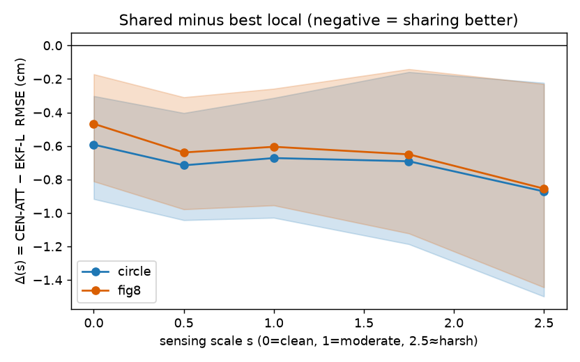

# P2d 報告（pilot；規格 docs/notes/p2d_prespec.md；全部是 pilot，不當正式結論）

## 1. 調參（moderate x1.0；seeds 2020-2024 x circle/fig8；平均 RMSE，>1 m/發散記 1 m）

選到邊界時延伸一次後停。表列各方法所有試過的點（RMSE cm / 成功率）。

**DOB**：選定 fc=16（4.09 cm，成功率 1.00）；階段 1 邊界：無；延伸後仍在邊界：無

| hp | RMSE cm | 成功率 |
|---|---|---|
| fc=16 ** | 4.09 | 1.00 |
| fc=64 | 4.13 | 1.00 |
| fc=1000 | 4.19 | 1.00 |
| fc=8 | 4.20 | 1.00 |
| fc=32 | 4.22 | 1.00 |
| fc=4 | 4.57 | 1.00 |
| fc=2 | 5.46 | 1.00 |
| fc=1 | 7.16 | 1.00 |

**LOC-M**：選定 lam=0.998,prior=1（3.93 cm，成功率 1.00）；階段 1 邊界：['lam:lo', 'prior:hi']；延伸後仍在邊界：['lam:lo']

| hp | RMSE cm | 成功率 |
|---|---|---|
| lam=0.998,prior=1 ** | 3.93 | 1.00 |
| lam=0.999,prior=2 | 3.98 | 1.00 |
| lam=0.999,prior=1 | 3.99 | 1.00 |
| lam=0.999,prior=0.5 | 4.01 | 1.00 |
| lam=0.9995,prior=0.5 | 4.02 | 1.00 |
| lam=0.9995,prior=1 | 4.02 | 1.00 |
| lam=0.9998,prior=0.5 | 4.04 | 1.00 |
| lam=0.9998,prior=1 | 4.05 | 1.00 |
| lam=1,prior=1 | 4.05 | 1.00 |
| lam=1,prior=0.5 | 4.06 | 1.00 |

**CEN-ATT**：選定 lam=0.9998,prior=2（2.85 cm，成功率 1.00）；階段 1 邊界：['prior:hi']；延伸後仍在邊界：['prior:hi']

| hp | RMSE cm | 成功率 |
|---|---|---|
| lam=0.9998,prior=2 ** | 2.85 | 1.00 |
| lam=0.9998,prior=1 | 2.85 | 1.00 |
| lam=0.9998,prior=0.5 | 2.85 | 1.00 |
| lam=0.9995,prior=1 | 2.85 | 1.00 |
| lam=1,prior=1 | 2.85 | 1.00 |
| lam=1,prior=0.5 | 2.85 | 1.00 |
| lam=0.9995,prior=0.5 | 2.85 | 1.00 |
| lam=0.999,prior=0.5 | 2.86 | 1.00 |
| lam=0.999,prior=1 | 2.86 | 1.00 |

**EKF-L**：選定 q_b=0.0005,r_scale=10（3.33 cm，成功率 1.00）；階段 1 邊界：['q_b:lo', 'r_scale:hi']；延伸後仍在邊界：無

| hp | RMSE cm | 成功率 |
|---|---|---|
| q_b=0.0005,r_scale=10 ** | 3.33 | 1.00 |
| q_b=0.0005,r_scale=30 | 3.33 | 1.00 |
| q_b=0.000125,r_scale=10 | 3.34 | 1.00 |
| q_b=0.002,r_scale=10 | 3.34 | 1.00 |
| q_b=0.000125,r_scale=3 | 3.54 | 1.00 |
| q_b=0.0005,r_scale=3 | 3.55 | 1.00 |
| q_b=0.002,r_scale=3 | 3.55 | 1.00 |
| q_b=0.008,r_scale=3 | 3.68 | 1.00 |
| q_b=0.002,r_scale=1 | 3.86 | 1.00 |
| q_b=0.0005,r_scale=1 | 3.88 | 1.00 |
| q_b=0.008,r_scale=1 | 4.01 | 1.00 |
| q_b=0.03,r_scale=3 | 4.52 | 1.00 |
| q_b=0.0005,r_scale=100 | 5.27 | 1.00 |
| q_b=0.03,r_scale=1 | 6.56 | 0.90 |

**偏離（使用者核准，2026-10-30）**：p2d_prespec 原規定選到邊界只延伸一次；EKF-L 的 r_scale 因此再延伸（新增 30、100，及在 r_scale=10 對 q_b 補 2e-3、1.25e-4 共 4 點）。r_scale=10 兩側都有點（3 和 30），q_b 兩側也有點，最佳不在邊界；最佳 hp 沒變，故 EKF-L 的底線、掃描、掉包結果不需重跑。舊版報告見 P2d_report_v1.md。

CON-ATT：共用 CEN-ATT 的 hp（lam=0.9998,prior=2）。

## 2. 雜訊底線（moderate x1.0；seeds 2020-2029，n=10；注意 2020-2024 同時是調參 seeds）

調參 seeds（2020-2024）RMSE cm：DOB 4.09；LOC-M 3.93；EKF-L 3.33；CEN-ATT 2.85；CON-ATT 2.85。最佳分享 = **CEN-ATT**，最佳本地 = **EKF-L**。

| 方法 | circle RMSE cm | fig8 RMSE cm | 兩軌平均 | 成功率 |
|---|---|---|---|---|
| DOB | 4.38 | 4.49 | 4.43 | 1.00 |
| LOC-M | 4.50 | 4.51 | 4.50 | 1.00 |
| EKF-L | 3.62 | 3.66 | 3.64 | 1.00 |
| CEN-ATT | 2.93 | 3.00 | 2.96 | 1.00 |
| CON-ATT | 2.91 | 2.97 | 2.94 | 1.00 |

主比較配對差 = 分享 − 本地（cm，負 = 分享較好）的 seed 間標準差：

| 比較 | 範圍 | 平均差 [CI] | sd | Δ=0.5 | Δ=0.75 | Δ=1.0 | Δ=本地RMSE 10% (cm) |
|---|---|---|---|---|---|---|---|
| **CEN-ATT − EKF-L** | pooled(兩軌平均/seed) | -0.68 [-1.23, -0.14] | 0.93 | 30 | 15 | 9 | 54（Δ=0.36） |
| **CEN-ATT − EKF-L** | circle | -0.69 [-1.22, -0.17] | 0.90 | 28 | 14 | 9 | 51（Δ=0.36） |
| **CEN-ATT − EKF-L** | fig8 | -0.66 [-1.25, -0.11] | 0.98 | 33 | 16 | 10 | 59（Δ=0.37） |
| CEN-ATT − DOB | pooled(兩軌平均/seed) | -1.47 [-1.90, -1.03] | 0.75 | 20 | 10 | 7 | 25（Δ=0.44） |
| CEN-ATT − DOB | circle | -1.45 [-1.91, -0.94] | 0.83 | 24 | 12 | 8 | 31（Δ=0.44） |
| CEN-ATT − DOB | fig8 | -1.50 [-1.93, -1.04] | 0.76 | 21 | 10 | 7 | 25（Δ=0.45） |
| CEN-ATT − LOC-M | pooled(兩軌平均/seed) | -1.54 [-2.50, -0.63] | 1.58 | 80 | 37 | 22 | 99（Δ=0.45） |
| CEN-ATT − LOC-M | circle | -1.57 [-2.51, -0.66] | 1.56 | 79 | 37 | 22 | 97（Δ=0.45） |
| CEN-ATT − LOC-M | fig8 | -1.51 [-2.49, -0.60] | 1.60 | 83 | 38 | 23 | 102（Δ=0.45） |
| CON-ATT − DOB | pooled(兩軌平均/seed) | -1.49 [-1.92, -1.05] | 0.76 | 20 | 10 | 7 | 25（Δ=0.44） |
| CON-ATT − DOB | circle | -1.47 [-1.93, -0.96] | 0.83 | 24 | 12 | 8 | 31（Δ=0.44） |
| CON-ATT − DOB | fig8 | -1.52 [-1.97, -1.05] | 0.77 | 21 | 11 | 7 | 26（Δ=0.45） |
| CON-ATT − LOC-M | pooled(兩軌平均/seed) | -1.56 [-2.52, -0.67] | 1.56 | 79 | 36 | 22 | 97（Δ=0.45） |
| CON-ATT − LOC-M | circle | -1.59 [-2.53, -0.69] | 1.56 | 78 | 36 | 21 | 96（Δ=0.45） |
| CON-ATT − LOC-M | fig8 | -1.53 [-2.51, -0.64] | 1.58 | 81 | 37 | 22 | 99（Δ=0.45） |
| CON-ATT − EKF-L | pooled(兩軌平均/seed) | -0.70 [-1.25, -0.17] | 0.92 | 29 | 14 | 9 | 53（Δ=0.36） |
| CON-ATT − EKF-L | circle | -0.71 [-1.24, -0.20] | 0.89 | 27 | 13 | 9 | 50（Δ=0.36） |
| CON-ATT − EKF-L | fig8 | -0.68 [-1.27, -0.14] | 0.97 | 32 | 15 | 10 | 57（Δ=0.37） |

註：n = ((z_{0.975}+z_{0.8}) sd/Δ)^2 + z_{0.975}^2/2（配對 t 的常態近似加 Guenther 修正；n 是每格的 seed 數，每格＝單一軌跡）。「pooled」列的 sd 是兩軌跡先平均後的 seed 間 sd，只在把兩軌跡合併成一格時適用。暫定 Δ = max(0.5 cm, 本地 RMSE 10%)，見 Δ=10% 欄。

## 3. 感測強度掃描（seeds 2200-2219，n=20；最佳分享=CEN-ATT、最佳本地=EKF-L，由調參 seeds 選定）

RMSE cm（兩軌跡平均）/ 成功率（兩軌跡 40 集）：

| s | DOB | LOC-M | EKF-L | CEN-ATT | CON-ATT |
|---|---|---|---|---|---|
| 0 | 2.83 / 1.00 | 3.76 / 1.00 | 3.03 / 1.00 | 2.50 / 1.00 | 2.48 / 1.00 |
| 0.5 | 3.49 / 1.00 | 4.12 / 1.00 | 3.44 / 1.00 | 2.77 / 1.00 | 2.75 / 1.00 |
| 1 | 4.33 / 1.00 | 4.46 / 1.00 | 3.54 / 1.00 | 2.90 / 1.00 | 2.86 / 1.00 |
| 1.75 | 6.31 / 0.97 | 5.50 / 1.00 | 4.10 / 1.00 | 3.43 / 1.00 | 3.39 / 1.00 |
| 2.5 | 8.64 / 0.90 | 6.65 / 0.97 | 4.68 / 1.00 | 3.82 / 1.00 | 3.78 / 1.00 |

分軌跡 RMSE cm：

| s | 軌跡 | DOB | LOC-M | EKF-L | CEN-ATT | CON-ATT |
|---|---|---|---|---|---|---|
| 0 | circle | 2.83 | 3.71 | 3.00 | 2.41 | 2.41 |
| 0 | fig8 | 2.84 | 3.80 | 3.06 | 2.59 | 2.56 |
| 0.5 | circle | 3.44 | 4.14 | 3.42 | 2.70 | 2.69 |
| 0.5 | fig8 | 3.53 | 4.10 | 3.47 | 2.83 | 2.81 |
| 1 | circle | 4.27 | 4.45 | 3.52 | 2.85 | 2.82 |
| 1 | fig8 | 4.38 | 4.47 | 3.55 | 2.95 | 2.90 |
| 1.75 | circle | 6.22 | 5.50 | 4.07 | 3.38 | 3.36 |
| 1.75 | fig8 | 6.40 | 5.50 | 4.12 | 3.47 | 3.42 |
| 2.5 | circle | 8.63 | 6.65 | 4.66 | 3.79 | 3.74 |
| 2.5 | fig8 | 8.66 | 6.66 | 4.70 | 3.84 | 3.82 |

**Δ(s) = CEN-ATT − EKF-L**（cm；負 = 分享較好；seed 配對 bootstrap 95% CI）：

| s | pooled | circle | fig8 |
|---|---|---|---|
| 0 | -0.53 [-0.86, -0.24] | -0.59 [-0.92, -0.30] | -0.47 [-0.81, -0.17] |
| 0.5 | -0.68 [-1.01, -0.36] | -0.72 [-1.04, -0.40] | -0.64 [-0.98, -0.31] |
| 1 | -0.64 [-0.98, -0.29] | -0.67 [-1.03, -0.31] | -0.60 [-0.95, -0.26] |
| 1.75 | -0.67 [-1.15, -0.15] | -0.69 [-1.19, -0.16] | -0.65 [-1.12, -0.14] |
| 2.5 | -0.86 [-1.47, -0.23] | -0.87 [-1.50, -0.22] | -0.85 [-1.44, -0.23] |

**CON-ATT − CEN-ATT**（cm）：

| s | pooled | circle | fig8 |
|---|---|---|---|
| 0 | -0.02 [-0.03, -0.00] | -0.01 [-0.02, +0.01] | -0.03 [-0.06, -0.01] |
| 0.5 | -0.02 [-0.04, -0.00] | -0.01 [-0.03, +0.01] | -0.03 [-0.05, -0.00] |
| 1 | -0.04 [-0.07, -0.02] | -0.03 [-0.09, +0.00] | -0.05 [-0.07, -0.02] |
| 1.75 | -0.04 [-0.07, -0.01] | -0.02 [-0.04, +0.00] | -0.05 [-0.12, -0.00] |
| 2.5 | -0.04 [-0.07, -0.01] | -0.05 [-0.09, -0.01] | -0.03 [-0.06, +0.01] |

補充（事後；不屬於主要量）：各分享法對各本地法的 pooled 差：

| s | CEN-ATT − DOB | CEN-ATT − LOC-M | CEN-ATT − EKF-L | CON-ATT − DOB | CON-ATT − LOC-M | CON-ATT − EKF-L |
|---|---|---|---|---|---|---|
| 0 | -0.33 [-0.48, -0.20] | -1.26 [-1.68, -0.85] | -0.53 [-0.86, -0.24] | -0.35 [-0.50, -0.22] | -1.27 [-1.71, -0.87] | -0.55 [-0.89, -0.25] |
| 0.5 | -0.72 [-0.93, -0.52] | -1.35 [-1.83, -0.89] | -0.68 [-1.01, -0.36] | -0.74 [-0.95, -0.54] | -1.37 [-1.84, -0.91] | -0.70 [-1.03, -0.38] |
| 1 | -1.43 [-1.76, -1.12] | -1.56 [-2.09, -1.03] | -0.64 [-0.98, -0.29] | -1.47 [-1.80, -1.16] | -1.60 [-2.13, -1.07] | -0.68 [-1.02, -0.34] |
| 1.75 | -2.88 [-3.48, -2.32] | -2.07 [-2.78, -1.37] | -0.67 [-1.15, -0.15] | -2.92 [-3.50, -2.37] | -2.11 [-2.80, -1.43] | -0.71 [-1.16, -0.21] |
| 2.5 | -4.83 [-5.75, -3.97] | -2.84 [-3.65, -2.02] | -0.86 [-1.47, -0.23] | -4.87 [-5.78, -4.01] | -2.87 [-3.68, -2.07] | -0.90 [-1.49, -0.28] |

**分界（Δ(s) 的 CI 完全 <0 的最小 s）**：pooled：CI 上界 <0 最小的 s = 0；最佳本地反超（CI 下界 >0）的 s = 無；circle：CI 上界 <0 最小的 s = 0；最佳本地反超（CI 下界 >0）的 s = 無；fig8：CI 上界 <0 最小的 s = 0；最佳本地反超（CI 下界 >0）的 s = 無

## 4. 掉包掃描（CON-ATT；moderate x1.0；seeds 2200-2219；p=0 沿用 sweep s=1）

| p_drop | CON RMSE cm（circle / fig8 / 平均） | 成功率 | CON − LOC-M(est) pooled [CI] | CON − EKF-L(est) pooled [CI] | circle 對 LOC-M / EKF-L | fig8 對 LOC-M / EKF-L |
|---|---|---|---|---|---|---|
| 0 | 2.82 / 2.90 / 2.86 | 1.00 | -1.60 [-2.13, -1.07] | -0.68 [-1.02, -0.34] | -1.63 [-2.15, -1.13] ; -0.71 [-1.05, -0.36] | -1.57 [-2.12, -1.01] ; -0.65 [-1.00, -0.30] |
| 0.5 | 2.78 / 2.88 / 2.83 | 1.00 | -1.63 [-2.17, -1.10] | -0.71 [-1.06, -0.36] | -1.67 [-2.20, -1.15] ; -0.74 [-1.11, -0.39] | -1.59 [-2.14, -1.05] ; -0.67 [-1.01, -0.33] |
| 0.9 | 2.58 / 2.72 / 2.65 | 1.00 | -1.81 [-2.32, -1.28] | -0.89 [-1.20, -0.57] | -1.87 [-2.38, -1.35] ; -0.94 [-1.27, -0.61] | -1.75 [-2.28, -1.21] ; -0.83 [-1.13, -0.52] |

## 5. 偏離與注意事項
見 docs/PROGRESS.md「P2d 結果」。

